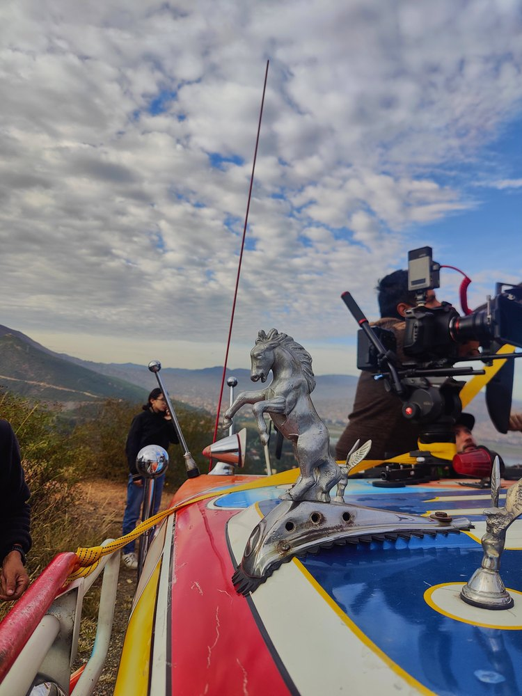

Este archivo es solo una **plantilla de formato**. No es un artículo real: sirve para revisar cómo se ve cada elemento antes de escribir los primeros posts. El primer párrafo funciona como entrada y puede llevar *énfasis* o [enlaces internos](/#services).

## Un subtítulo de sección (H2)

Los párrafos tienen un ancho máximo cómodo para leer. Este es texto de relleno para comprobar el interlineado, el color y el tamaño de la fuente en pantallas grandes y pequeñas.

### Un subtítulo menor (H3)

Lista con viñetas:

- Primer punto de la lista.
- Segundo punto, con un poco más de texto para ver cómo se comporta cuando ocupa dos líneas en móvil.
- Tercer punto con `código en línea`.

Lista numerada:

1. Paso uno.
2. Paso dos.
3. Paso tres.

> Una cita destacada se ve así. Sirve para resaltar una idea clave del artículo.

## Imagen con pie de foto



También funciona la sintaxis normal de Markdown para imágenes sin pie:



## Tarjeta de reel de Instagram

Las tarjetas enlazan al reel sin cargar scripts de Instagram:



## Bloque de código

```
Ejemplo de bloque de código o de un prompt:
línea 1
línea 2
```

---

Cierre del artículo. Después de este texto aparecen automáticamente el bloque de suscripción a Fabio AI Lab, la llamada a la acción y los enlaces al artículo anterior y siguiente.
